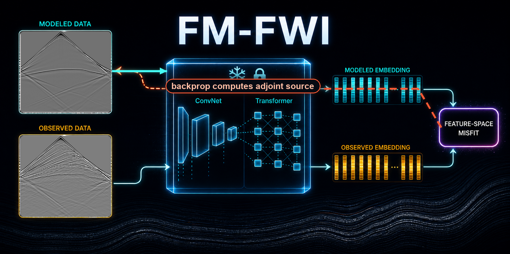

# FM-FWI



A foundation-model objective function for full waveform inversion (FWI):
seismic data is matched in the feature space of a pretrained SeisLM
(seismic foundation model) encoder instead of (or in addition to) raw
amplitudes, using [Devito](https://www.devitoproject.org/) /
[Devito-fwi](https://github.com/DIG-Kaust/Devito-fwi) for wave modelling.

This repo vendors only the part of
[liutianlin0121/seisLM](https://github.com/liutianlin0121/seisLM) actually
needed to load a pretrained SeisLM encoder and run a forward pass — the
`fm_fwi/model/` code is a stripped-down copy of seisLM's
`seisLM/model/foundation/`, with the `lightning`/`seisbench`/`torchtune`
training-time dependencies removed (checkpoints are loaded directly with
`torch.load`, and `torch.nn.RMSNorm` is used in place of the
`torchtune`/`torchao` fallback). It is independent of the main seisLM repo
on purpose: changes there won't break this project.

## Project structure
This repository is organized as follows:

* :open_file_folder: **fm_fwi**: the installable Python package — the
  vendored SeisLM encoder (`fm_fwi/model/`) and the FWI feature/L2/hybrid
  loss functions (`fm_fwi/losses.py`);
* :open_file_folder: **data**: instructions for retrieving the velocity
  models and pretrained checkpoint used by the notebooks (not tracked in
  git — see `data/README.md`);
* :open_file_folder: **notebooks**: Jupyter notebooks reproducing the FWI
  experiments (see below);
* :open_file_folder: **pytests**: unit tests for `fm_fwi/model/`.

## Notebooks
The following notebooks are provided:

- :orange_book: ``SeisLM_Marmousi.ipynb``: acoustic FWI on the Marmousi
  velocity model;
- :orange_book: ``SeisLM_Overthrust2D.ipynb``: acoustic FWI on the 2D
  Overthrust velocity model.

Both compare an L2 data-misfit objective against the SeisLM feature-space
objective (`fm_fwi.losses.SeisLMFeatureLoss` / `HybridLoss`).

## Getting started :space_invader: :robot:
To ensure reproducibility of the results, we suggest using the
`environment.yml` file when creating an environment. Simply run:
```
./install_env.sh
```
It creates the `fmfwi` conda environment, installs a torch build matching
your GPU's CUDA driver (or a CPU-only build if no GPU is detected), installs
Devito/Devito-fwi, and installs this package itself in editable mode. If at
the end you see the word `Done!` on your terminal you are ready to go.

Remember to always activate the environment by typing:
```
conda activate fmfwi
```

To run the unit tests (these additionally need `pytest` and `transformers`,
since some compare the vendored model against HuggingFace's reference
Wav2Vec2 implementation):
```
pip install -e .[dev]
pytest pytests/
```

Before running the notebooks, see `data/README.md` for what to download and
where to place it.

**Disclaimer:** developed and tested with an NVIDIA GPU (CUDA 12.x driver);
`install_env.sh` falls back to a CPU-only torch build automatically if no
GPU is found, though FWI runs will be substantially slower.
